# Islet

**Uma ilha no notch do Mac.** Avisos, controles e o que importa no dia, num só lugar do topo da tela. No Mac sem notch, ou com o monitor externo, ela vira uma pílula sobre a barra de menus.

[Baixar a última versão](https://github.com/WildesPiva/islet-releases/releases/latest) · [English below](#english)

  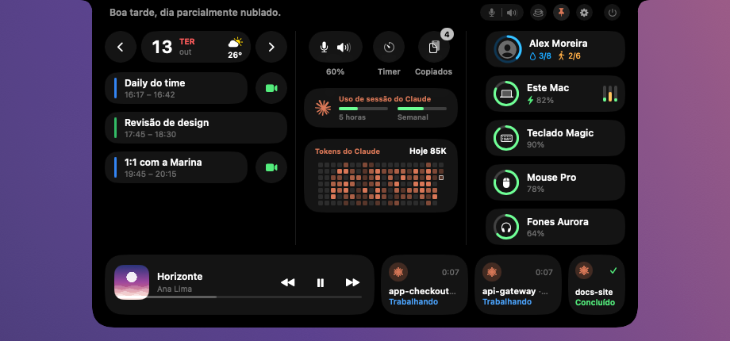

Todas as capturas usam dados fictícios. / All screenshots use fictional data.

## Em ação / In action

**Notificações pela ilha / Alerts on the island**

  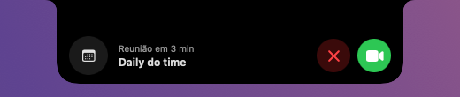
  
  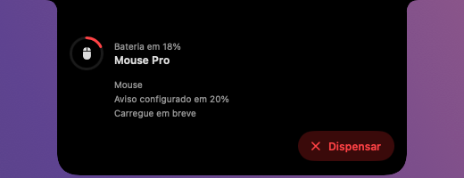
  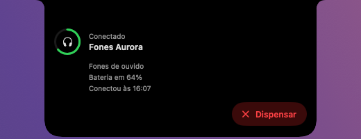

**Claude Code: responda sem sair do que está fazendo / Answer without leaving what you're doing**

  
  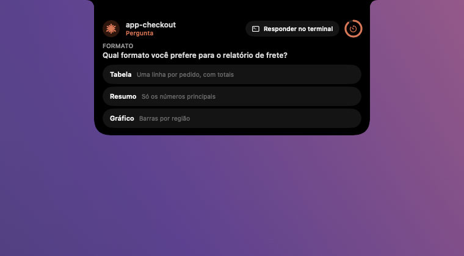

**Central de notificações e atividades ao vivo / Notification center and live activities**

  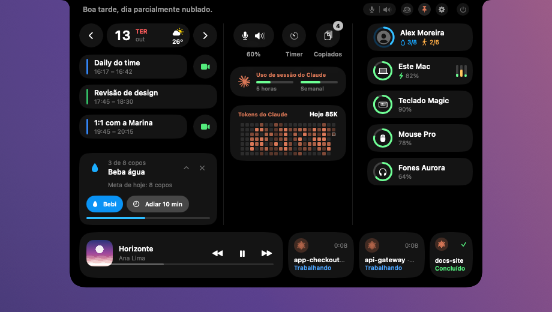
  

**Temas / Themes**

  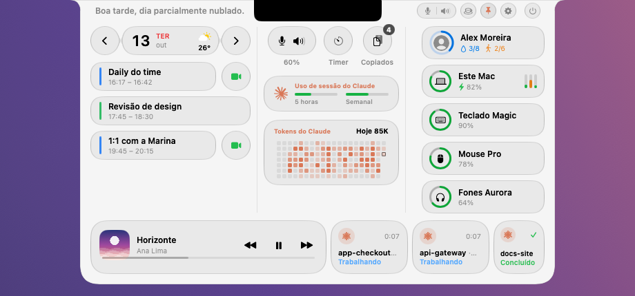
  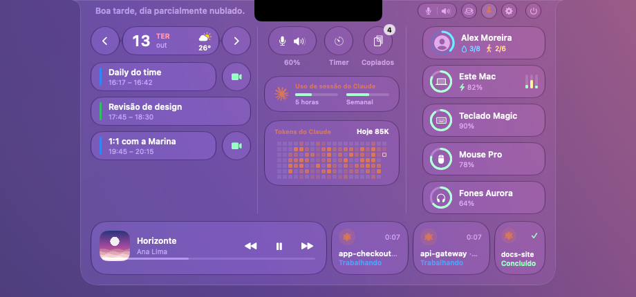

**Ajustes / Settings**

  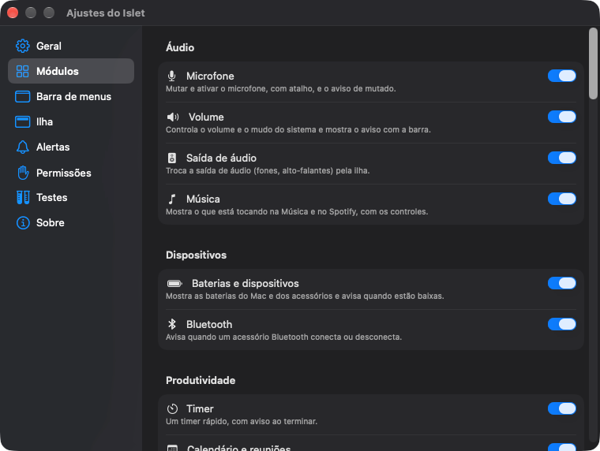
  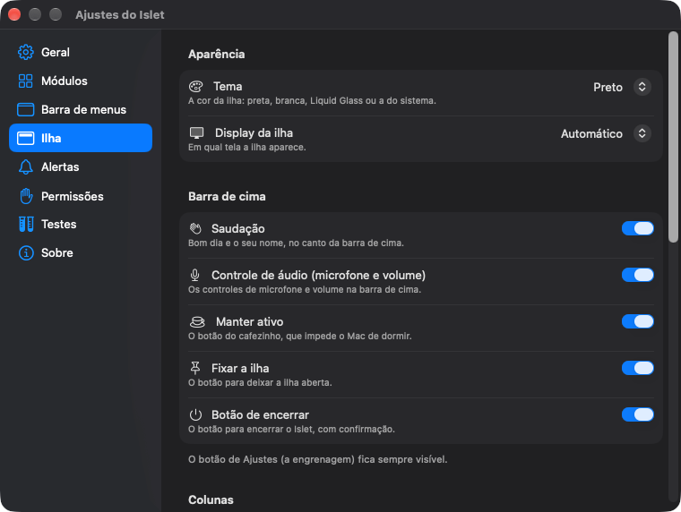
  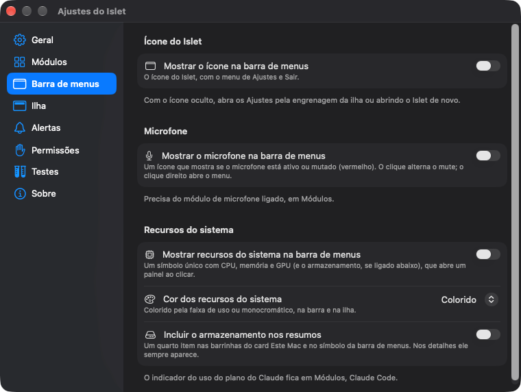

## O que ele faz

- **Uma ilha que muda de forma:** recolhida, em notificação e expandida, com Liquid Glass nos controles.
- **Microfone:** avisa ao mutar e ao ativar; mute por clique, por atalho global ou por um ícone opcional na barra de menus; você escolhe qual microfone mutar.
- **Áudio:** volume, troca da saída de áudio e o que está tocando no Música e no Spotify, com capa, progresso e controles.
- **Tempo:** timer em régua e "manter o Mac ativo" com duração.
- **Agenda:** calendário do dia, próximo evento, aviso antes das reuniões e um botão para entrar (Zoom, Meet, Teams, FaceTime).
- **Dispositivos:** bateria do Mac e dos acessórios, com aviso de bateria baixa e de bateria acabando, e aviso de Bluetooth conectado ou desconectado.
- **Clima:** a temperatura do dia na agenda e os detalhes ao clicar.
- **Área de transferência:** os últimos itens copiados (texto, imagens e arquivos), só em memória.
- **Saúde e bem-estar:** lembretes de água e de movimento, que você responde pela própria ilha.
- **Claude Code:** responda permissões e perguntas pela ilha, veja as sessões abertas, acompanhe os limites do plano (5 horas e semanal) e um mapa de calor dos tokens consumidos por dia.
- **Recursos do sistema:** CPU, memória, GPU e armazenamento, na ilha e, se quiser, na barra de menus.
- **Central de notificações:** o que você perdeu fica por alguns segundos embaixo da agenda, quando você abre a ilha.
- **Temas:** Preto, Branco, Liquid Glass ou o do sistema. Em português do Brasil e em inglês.

## Requisitos

macOS 26 (Tahoe) ou mais novo.

## Instalar

1. Baixe o `Islet-<versão>.zip` na [última release](https://github.com/WildesPiva/islet-releases/releases/latest).
2. Descompacte e arraste o `Islet.app` para a pasta Aplicativos.
3. Na primeira abertura o macOS pode avisar que o app não é de um desenvolvedor identificado, porque o Islet **não é notarizado pela Apple**. Clique com o botão direito no app e escolha **Abrir**, ou vá em Ajustes do Sistema > Privacidade e Segurança > **Abrir Mesmo Assim**. As atualizações baixadas pelo próprio app não pedem isso de novo.
4. As permissões são pedidas só quando o recurso é usado pela primeira vez: Calendário, localização aproximada (clima), Bluetooth e Automação (Música, Spotify e o terminal do Claude Code).

O Islet **não grava nem ouve áudio**: ele só lê e altera o estado de mute do microfone.

## Atualizações

O app se atualiza sozinho (via [Sparkle](https://sparkle-project.org)): ele verifica este repositório, avisa pela ilha e instala quando você aceita. Para desligar a verificação automática, use Ajustes > Sobre.

## Privacidade

Sem conta, sem análise de uso e sem telemetria. A rede é usada só para:

- **Atualizações:** consultar a lista de versões neste repositório.
- **Clima:** pedir a previsão ao [Open-Meteo](https://open-meteo.com), com a **localização aproximada** (coordenadas arredondadas a duas casas decimais) ou o nome da cidade que você escolheu. O nome do lugar também pode ser resolvido pela geocodificação reversa da Apple.
- **Sugestão de exercício (opcional, em Ajustes):** roda o `claude` que **você** já tem instalado, com um pedido fixo e genérico, no máximo algumas vezes por dia. Nada pessoal vai no pedido.

Todo o resto (calendário, Bluetooth, área de transferência, sessões e uso do Claude Code) é lido e fica no seu Mac. A integração com o Claude Code só edita o seu `~/.claude/settings.json` depois de mostrar a prévia, fazer backup e pedir confirmação, e tem um botão para remover.

## Licença

Freeware, todos os direitos reservados. Use à vontade, de graça, em quantos Macs quiser, mas **a redistribuição é só por este repositório** (indicar o link é bem-vindo). Os termos completos estão em [LICENSE](LICENSE) e os avisos de componentes de terceiros em [THIRD-PARTY-NOTICES.md](THIRD-PARTY-NOTICES.md).

Claude é marca da Anthropic. Apple, macOS, Mac, Liquid Glass e SF Symbols são marcas ou materiais da Apple. O Islet é um projeto independente e não tem vínculo nem apoio dessas empresas.

---

## English

**An island on your Mac's notch.** Alerts, controls and what matters during the day, in one place at the top of the screen. On a Mac without a notch, or on an external display, it becomes a pill over the menu bar.

[Download the latest version](https://github.com/WildesPiva/islet-releases/releases/latest)

### What it does

- **A shape-shifting island:** collapsed, as a notification and expanded, with Liquid Glass controls.
- **Microphone:** alerts when you mute or unmute; mute by click, global shortcut or an optional menu bar icon; you choose which microphone to mute.
- **Audio:** volume, audio output switching and now playing from Music and Spotify, with artwork, progress and controls.
- **Time:** a ruler-style timer and "keep Mac awake" with a duration.
- **Agenda:** today's calendar, next event, a heads-up before meetings and a button to join (Zoom, Meet, Teams, FaceTime).
- **Devices:** Mac and accessory battery with low-battery and almost-empty alerts, and Bluetooth connect and disconnect alerts.
- **Weather:** the day's temperature in the agenda and details on click.
- **Clipboard:** the last items you copied (text, images and files), in memory only.
- **Health and well-being:** water and movement reminders you answer from the island itself.
- **Claude Code:** answer permission requests and questions from the island, see open sessions, track plan limits (5-hour and weekly) and a heatmap of tokens used per day.
- **System resources:** CPU, memory, GPU and storage, on the island and, if you want, in the menu bar.
- **Notification center:** what you missed stays for a few seconds under the agenda when you open the island.
- **Themes:** Black, White, Liquid Glass or the system's. Available in Brazilian Portuguese and English.

### Requirements

macOS 26 (Tahoe) or later.

### Install

1. Download `Islet-<version>.zip` from the [latest release](https://github.com/WildesPiva/islet-releases/releases/latest).
2. Unzip it and drag `Islet.app` to the Applications folder.
3. On first launch macOS may warn that the app is from an unidentified developer, because Islet is **not notarized by Apple**. Right-click the app and choose **Open**, or go to System Settings > Privacy & Security > **Open Anyway**. Updates downloaded by the app itself do not ask again.
4. Permissions are requested only the first time a feature needs them: Calendar, approximate location (weather), Bluetooth and Automation (Music, Spotify and the Claude Code terminal).

Islet **does not record or listen to audio**: it only reads and changes the microphone's mute state.

### Updates

The app updates itself (through [Sparkle](https://sparkle-project.org)): it checks this repository, tells you on the island and installs when you accept. To turn the automatic check off, use Settings > About.

### Privacy

No account, no usage analytics, no telemetry. The network is used only for:

- **Updates:** reading the version list in this repository.
- **Weather:** asking [Open-Meteo](https://open-meteo.com) for the forecast with your **approximate location** (coordinates rounded to two decimals) or the city you chose. The place name may also be resolved through Apple's reverse geocoding.
- **Exercise suggestion (optional, in Settings):** runs the `claude` that **you** already have installed, with a fixed generic request, a few times a day at most. Nothing personal is in the request.

Everything else (calendar, Bluetooth, clipboard, Claude Code sessions and usage) is read and stays on your Mac. The Claude Code integration only edits your `~/.claude/settings.json` after showing a preview, making a backup and asking for confirmation, and has a button to remove it.

### License

Freeware, all rights reserved. Use it freely, at no cost, on as many Macs as you like, but **redistribution is only through this repository** (pointing people to the link is welcome). Full terms in [LICENSE](LICENSE) and third-party component notices in [THIRD-PARTY-NOTICES.md](THIRD-PARTY-NOTICES.md).

Claude is a trademark of Anthropic. Apple, macOS, Mac, Liquid Glass and SF Symbols are trademarks or materials of Apple. Islet is an independent project and is not affiliated with or endorsed by those companies.
